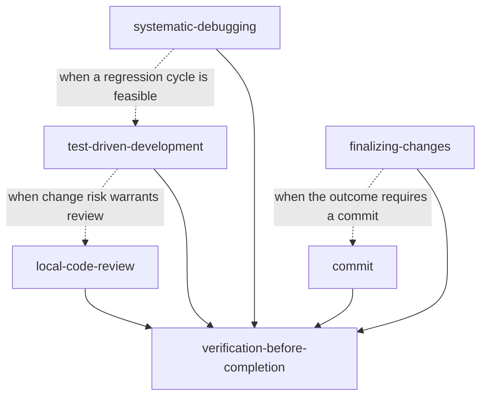

# opencode-skills

A personal skills, command, and agent library for [OpenCode](https://opencode.ai). The content targets OpenCode's built-in tool surface and execution workflows.

## Installation

OpenCode discovers user skills under `~/.config/opencode/skills/`, command files in `~/.config/opencode/commands/`, and agent files in `~/.config/opencode/agents/`. Clone the repository, then symlink each entry:

```sh
git clone https://github.com/fgladisch/opencode-skills.git ~/code/opencode-skills
mkdir -p ~/.config/opencode/skills ~/.config/opencode/commands ~/.config/opencode/agents
for skill in "$HOME"/code/opencode-skills/skills/*; do
  ln -sfn "$skill" "$HOME/.config/opencode/skills/$(basename "$skill")"
done
for command in "$HOME"/code/opencode-skills/commands/*.md; do
  ln -sfn "$command" "$HOME/.config/opencode/commands/$(basename "$command")"
done
for agent in "$HOME"/code/opencode-skills/agents/*.md; do
  ln -sfn "$agent" "$HOME/.config/opencode/agents/$(basename "$agent")"
done
```

For a checkout elsewhere, replace `"$HOME"/code/opencode-skills` with its path. OpenCode watches its configuration directories and picks up added or removed entries without a restart; run `/reload` to force it.

Skills in `~/.config/opencode/skills/` take precedence over skills with the same ID in `~/.agents/skills/` or `~/.claude/skills/`, so these versions win when another library shares the names.

## Commands

| Command              | Purpose                                                 |
| -------------------- | ------------------------------------------------------- |
| `local-review-cycle` | Review local changes in Hunk and apply fixes until LGTM |
| `pr`                 | Validate the work and publish it as a pull request      |
| `pr-review-loop`     | Address review feedback on an open PR until LGTM        |

## Agents

| Agent      | Purpose                                                                                                       |
| ---------- | ------------------------------------------------------------------------------------------------------------- |
| `reviewer` | Read-only review subagent that `local-code-review` dispatches once per category; posts findings as Hunk notes |

## Skills

| Skill                            | When to use                                                                                                           |
| -------------------------------- | --------------------------------------------------------------------------------------------------------------------- |
| `commit`                         | When the user asks to commit changes; follows repository conventions with gitmoji as the fallback                     |
| `finalizing-changes`             | When a coherent set of changes is ready to validate and then commit, merge, publish as a PR, or retain                |
| `local-code-review`              | When reviewing local code changes in a working tree, branch, commit, or defined file set; findings land as Hunk notes |
| `systematic-debugging`           | When a bug, failing test, build failure, performance regression, or unexpected behavior needs diagnosis               |
| `test-driven-development`        | Before the first production-code edit for any behavior change or bug fix                                              |
| `verification-before-completion` | Before claiming work is complete, fixed, passing, reviewed, ready, committed, or integrated                           |

## Skill dependency graph



Arrows mean the source skill explicitly applies the target skill, and dashed edges are conditional. TDD requests independent review only when compatibility, security, data-integrity, or operational risk warrants the additional pass.

## OpenSpec (optional)

[OpenSpec](https://github.com/Fission-AI/OpenSpec) is the recommended way to plan changes with these skills; it replaces ad hoc planning with the `plan` agent. Each change gets a proposal, delta specs with WHEN/THEN scenarios, a design, and a task list before code is written. The skills work without it. When the current work implements an active OpenSpec change, they also use its artifacts:

| Skill                            | With an active OpenSpec change                                                             |
| -------------------------------- | ------------------------------------------------------------------------------------------ |
| `test-driven-development`        | Turns each delta-spec scenario into a failing test before the task that implements it      |
| `verification-before-completion` | Treats checked `tasks.md` items as claims that need evidence; runs `openspec validate`     |
| `local-code-review`              | Gives reviewers the proposal and delta specs as the intended behavior                      |
| `finalizing-changes`             | Writes the pull request What and Why from the proposal; leaves archiving until after merge |

Initialize each repository with the core profile. For OpenCode, OpenSpec installs its workflow as project skills under `.opencode/skills/`:

```sh
openspec init --tools opencode --profile core
```

A change runs through these steps. Load each OpenSpec skill by mentioning it in the prompt, such as `@openspec-propose add dark mode`:

1. `@openspec-explore` to investigate when the idea is still open.
2. `@openspec-propose <idea>` to create the change; review and edit its artifacts.
3. Create the topic branch, then `@openspec-apply-change` to implement the tasks.
4. `/local-review-cycle` or `local-code-review` to review the result.
5. `finalizing-changes` or `/pr` to publish it, then `/pr-review-loop` to address the pull request review.
6. After the merge, `@openspec-archive-change` on the base branch to merge the delta specs into `openspec/specs/`, then commit the result.

## OpenCode tooling

- `question` provides structured decisions.
- `read`, `glob`, `grep`, `edit`, `write`, and `patch` handle repository inspection and changes before shell fallbacks. OpenCode has no symbol-navigation or debugger tool, so the skills trace symbols with `grep` and `read` and confirm with the project's type checker.
- `shell` runs finite commands; `shell` with `background: true` runs services and watchers that notify the session when they exit. Pull request and issue state comes from `gh` through `shell`.
- `subagent` runs child sessions; several calls in one response run in parallel. The `reviewer` agent in this repository is the review subagent.
- The `browser` Code Mode namespace, reached through `execute`, verifies UI behavior when the OpenCode desktop app provides a browser.
- [Hunk](https://hunk.dev/) is required for `local-code-review` and `local-review-cycle`: findings, decisions, and fixes are recorded as note threads in a live `hunk diff` session, and `verification-before-completion` checks those threads before completion claims.
- Skills load through the `skill` tool, which also returns the skill's base directory so supporting files resolve by relative path.
- Project instructions live in `AGENTS.md`; OpenCode loads them as repository context.

## License

MIT — see [LICENSE](LICENSE).
