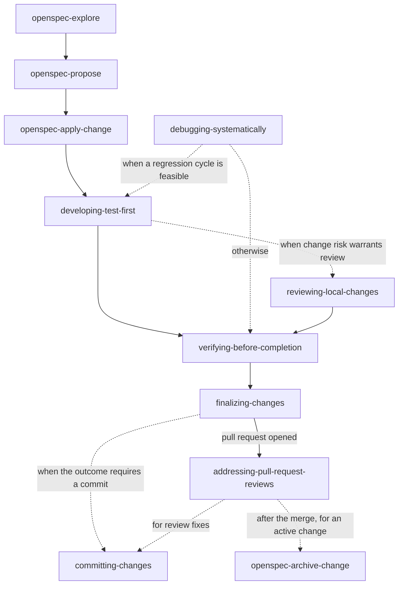

# opencode-workflow

A personal skills, command, and agent library for [OpenCode](https://opencode.ai). The content targets OpenCode's built-in tool surface and execution workflows.

## Installation

OpenCode discovers user skills under `~/.config/opencode/skills/`, command files in `~/.config/opencode/commands/`, and agent files in `~/.config/opencode/agents/`. Clone the repository, then symlink each entry:

```sh
git clone https://github.com/fgladisch/opencode-workflow.git ~/code/opencode-workflow
mkdir -p ~/.config/opencode/skills ~/.config/opencode/commands ~/.config/opencode/agents
for skill in "$HOME"/code/opencode-workflow/skills/*; do
  ln -sfn "$skill" "$HOME/.config/opencode/skills/$(basename "$skill")"
done
for command in "$HOME"/code/opencode-workflow/commands/*.md; do
  ln -sfn "$command" "$HOME/.config/opencode/commands/$(basename "$command")"
done
for agent in "$HOME"/code/opencode-workflow/agents/*.md; do
  ln -sfn "$agent" "$HOME/.config/opencode/agents/$(basename "$agent")"
done
```

For a checkout elsewhere, replace `"$HOME"/code/opencode-workflow` with its path. OpenCode watches its configuration directories and picks up added or removed entries without a restart; run `/reload` to force it.

Skills in `~/.config/opencode/skills/` take precedence over skills with the same ID in `~/.agents/skills/` or `~/.claude/skills/`, so these versions win when another library shares the names.

To make agents follow the [skill workflow](#skill-workflow), copy the global [`AGENTS.md` gist](https://gist.github.com/fgladisch/ee63b2d81b6714134f411c53a888f07c) to `~/.config/opencode/AGENTS.md`. It lists the skills in workflow order with the condition for loading each one, and adds defaults for branches, commits, tests, and subagents.

## Commands

| Command              | Purpose                                                                                                              |
| -------------------- | -------------------------------------------------------------------------------------------------------------------- |
| `local-review-cycle` | Review local changes in Hunk and apply fixes until LGTM                                                              |
| `pr`                 | When the work is done, validate it, publish it as a pull request, and address its review, skipping optional findings |

## Agents

| Agent      | Purpose                                                                                                             |
| ---------- | ------------------------------------------------------------------------------------------------------------------- |
| `reviewer` | Read-only review subagent that `reviewing-local-changes` dispatches once per category; posts findings as Hunk notes |

## Skills

| Skill                             | When to use                                                                                                                        |
| --------------------------------- | ---------------------------------------------------------------------------------------------------------------------------------- |
| `addressing-pull-request-reviews` | When asked to wait for, address, or babysit pull request review feedback or CI until LGTM; waits only through a bounded script     |
| `committing-changes`              | Before every git commit, requested or self-initiated; follows repository conventions with gitmoji as the fallback                  |
| `debugging-systematically`        | When a bug, failing test, build failure, performance regression, or unexpected behavior needs diagnosis                            |
| `developing-test-first`           | Before writing production code for a new app, feature, behavior change, or bug fix, including greenfield work                      |
| `finalizing-changes`              | When a coherent set of changes is ready to validate and then commit, merge, publish as a PR, or retain, including wrap-up requests |
| `reviewing-local-changes`         | When asked to review local changes in a working tree, branch, commit, or file set, or on a handoff; findings land as Hunk notes    |
| `verifying-before-completion`     | As the completion gate before the final report of every coding task, even when tests already pass                                  |

## Skill Workflow



The graph shows the order in which the skills run during a change; dashed arrows are conditional steps. The OpenSpec skills apply only when the repository uses [OpenSpec](#openspec-optional); without it, a change starts at `developing-test-first`, or at `debugging-systematically` for a bug. Along the way, skills also load each other: `finalizing-changes`, for example, loads `committing-changes` and `verifying-before-completion`. Each `SKILL.md` names the skills it loads. TDD requests independent review only when compatibility, security, data-integrity, or operational risk warrants the additional pass.

## OpenSpec (optional)

[OpenSpec](https://github.com/Fission-AI/OpenSpec) is the recommended way to plan changes with these skills; it replaces ad hoc planning with the `plan` agent. Each change gets a proposal, delta specs with WHEN/THEN scenarios, a design, and a task list before code is written. The skills work without it. When the current work implements an active OpenSpec change, they also use its artifacts:

| Skill                         | With an active OpenSpec change                                                             |
| ----------------------------- | ------------------------------------------------------------------------------------------ |
| `developing-test-first`       | Turns each delta-spec scenario into a failing test before the task that implements it      |
| `verifying-before-completion` | Treats checked `tasks.md` items as claims that need evidence; runs `openspec validate`     |
| `reviewing-local-changes`     | Gives reviewers the proposal and delta specs as the intended behavior                      |
| `finalizing-changes`          | Writes the pull request What and Why from the proposal; leaves archiving until after merge |

Initialize each repository with the core profile. For OpenCode, OpenSpec installs its workflow as project skills under `.opencode/skills/`:

```sh
openspec init --tools opencode --profile core
```

A change runs through these steps. Load each OpenSpec skill by mentioning it in the prompt, such as `@openspec-propose add dark mode`:

1. `@openspec-explore` to investigate when the idea is still open.
2. `@openspec-propose <idea>` to create the change; review and edit its artifacts.
3. Create the topic branch, then `@openspec-apply-change` to implement the tasks.
4. `/local-review-cycle` or `reviewing-local-changes` to review the result.
5. `/pr` to publish it and address the pull request review, or `finalizing-changes` followed by `addressing-pull-request-reviews`.
6. After the merge, `@openspec-archive-change` on the base branch to merge the delta specs into `openspec/specs/`, then commit the result.

## OpenCode tooling

- `question` provides structured decisions.
- `read`, `glob`, `grep`, `edit`, `write`, and `patch` handle repository inspection and changes before shell fallbacks. OpenCode has no symbol-navigation or debugger tool, so the skills trace symbols with `grep` and `read` and confirm with the project's type checker.
- `shell` runs finite commands; `shell` with `background: true` runs services and watchers that notify the session when they exit. Pull request and issue state comes from `gh` through `shell`.
- `subagent` runs child sessions; several calls in one response run in parallel. The `reviewer` agent in this repository is the review subagent.
- The `browser` Code Mode namespace, reached through `execute`, verifies UI behavior when the OpenCode desktop app provides a browser.
- [Hunk](https://hunk.dev/) is required for `reviewing-local-changes` and `local-review-cycle`: findings, decisions, and fixes are recorded as note threads in a live `hunk diff` session, and `verifying-before-completion` checks those threads before completion claims.
- Skills load through the `skill` tool, which also returns the skill's base directory so supporting files resolve by relative path.
- Project instructions live in `AGENTS.md`; OpenCode loads them as repository context.

## Evaluations

`evals/<skill>.json` holds three scenarios per skill, following the evaluation structure from Anthropic's [Skill authoring best practices](https://platform.claude.com/docs/en/agents-and-tools/agent-skills/best-practices). Each scenario has a realistic `query` that never names a skill, an optional `fixture` from `evals/fixtures/` with `setup` commands that plant the starting state, the `skills` that must load, and an `expected_behavior` rubric.

```sh
node evals/run.mjs <skill> [index ...] [--model provider/model#variant] [--dry-run] [--timeout <minutes>]
```

The fixture `evals/fixtures/todo-api/` is a TypeScript NestJS todo API; `pnpm verify` runs its typecheck, lint, format check, tests, and build. The runner prepares a throwaway Git repository per scenario, installs fixture dependencies with `pnpm install --frozen-lockfile` (pnpm is required), runs the query through `opencode run --auto`, and reports which skills loaded. Runs never see your global `~/.config/opencode/AGENTS.md`, so they measure what the skill descriptions trigger on their own: each run uses a private server (`--standalone`) whose config home mirrors yours without that file. It exits non-zero when an expected skill did not load; grade the printed rubric by hand from the kept work directory. `--dry-run` prepares the repository without calling OpenCode.

## Script tests

Scripts bundled with a skill, such as `addressing-pull-request-reviews/wait-for-review.mjs`, have tests in `tests/` that run against a fake `gh`:

```sh
node --test tests/*.test.mjs
```

## License

MIT — see [LICENSE](LICENSE).
